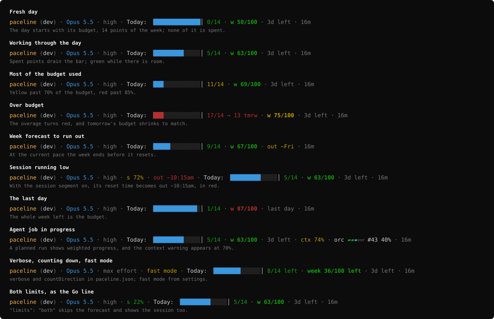

# paceline (mod)

A Claude Code mod that paces your usage limits and shows, at a glance, where every session stands, in a line above the prompt.



Colors follow your terminal's palette, with fixed colors for the project name and for red. See [every state](#every-state) for what each one means.
```
paceline (dev) · Opus 5.5 · high · Today: ▕██████░░░░░░░░│ 8/14 · w 43/100 · 4d left · 59m
```

`Today:` is today's budget as a bar that drains as you use it: full cells are what's left, and the `│` marker is an even day's share of the week. `8/14` is the weekly points you've spent of today's 14. `w 43/100` is the week so far, and `4d left` is the days until it resets. If your current pace would use up the week before then, `4d left` turns into a warning, `out ~Tue`: the week is forecast to run out on Tuesday. On a normal day, you never see it. See [Run-out warnings](#run-out-warnings).

Your weekly limit resets on a fixed schedule, but Claude Code only tells you how much is left, not whether that's a lot or a little for the days remaining. paceline divides what's left by the days until the reset and gives you **today's budget**, then counts up how much of it you've used as you work. A light week gives you a big budget; a heavy one, a small budget.

This is the mod version of [paceline](https://github.com/rogadev/paceline), the Go status line. Its segments come from the same math, checked against the same test fixtures, but it installs as a plugin, draws in the band above the prompt, puts the project first, and says when a usage limit is about to run out.

## Install

In a Claude Code session in your terminal, add this repo as a marketplace, then install the plugin from it:

```
/plugin marketplace add rogadev/paceline-mod
/plugin install paceline@paceline-mod
```

Pick a scope when asked (user scope puts it in every session). The line appears above the prompt right away.

Requirements:

- Claude Code v2.1.287 or later. Run `claude --version` to check.
- The line draws in the terminal and in the Code tab of the Claude Desktop app. The VS Code extension's chat panel and `claude -p` don't draw mods.

To hide the line for a while, click the `[-]` at the right end of the band, or press Ctrl+X then Ctrl+A. To remove it, uninstall the plugin from the **Installed** tab in `/plugin`.

## What each segment means

| Segment | Example | Shows |
|---|---|---|
| Project | `paceline (dev)` | The folder, in a color unique to the project, and the git branch. Always first. |
| Model | `Opus 5.5` | The model. |
| Effort | `high` | The effort level, only when it's above `low` or `medium`. Verbose: `high effort`. |
| Fast mode | `fast mode` | Only while fast mode is on. |
| Session | `s 4%` | Off by default; turn it on with `segments.session`. How much of the five-hour limit you've used, with its reset time once less than 30% is left, or `out ~3:45pm` when it's forecast to run out first. |
| Today | `Today: ▕██████░░░░░░░░│ 8/14` | Today's budget as a bar, one cell per weekly point, then the points spent of the budget. See [Today's bar](#todays-bar). |
| Week | `w 43/100 · 4d left` | How much of the weekly limit you've used, then the days until it resets, or `last day`. When the week is forecast to run out first, `out ~Tue` replaces the days left. From three days out, the figure turns bold. Verbose: `week 43/100`. |
| Context | `ctx 72%` | Only when the context window is 70% or more full. |
| Progress | `loop ▰▰▰▰▱ #44 3/5` | Only while an agent reports a long job's progress. See [Progress bar](#progress-bar). |
| Loop | `loop ▰▰▰▱▱ #44 2/5` | Only during an `/orc-loop` run that doesn't report through the progress tools. See [Loop and batch](#loop-and-batch). |
| Batch | `7 issues · 2 reviews · ✓ ready` | Where the current dev -> main batch stands in deep-review, in repos that keep a review ledger. See [Loop and batch](#loop-and-batch). |
| Duration | `16m` | Session wall-clock time. Always last. |

**Today's budget** is the weekly percentage left at the start of the day, divided by the days from midnight to the reset. It stays fixed all day. Whatever you don't spend spreads over the remaining days. Today and the week are both in weekly percentage points, so `8/14` and `w 43/100` add up. The numbers' color is your pace: green while you have room, yellow once you've used more than 70% of the budget, and red past 85%. On the final day before the reset, the budget is everything left in the week.

### Today's bar

The bar has one cell per weekly point, against a `│` marker at the even daily share of 100 / 7, about 14 points.

- **Full cells** (cyan) are the budget you have left; **drained cells** (`░`) are what you've spent.
- **A budget above the even share** starts with full cells past the marker and a green `+6 saved` tag. You spend that surplus first, so the bar shortens and the tag shrinks.
- **A budget below the even share**, after overspending earlier in the week, shows the missing part as a faint red stretch (`▒`) before the marker.
- **Past the budget**, the numbers turn red, the full cells turn red and count the overage, and `→ 11 tmrw` shows what tomorrow's budget drops to. On the last day, `out ~4pm` shows when the week runs out at today's pace instead.
- A bar longer than 28 cells scales down to fit, marker included.

**Project colors** come from a hash of the project folder name, mapped to one of 12 evenly spaced hues in the OKLCH color space, so every color is equally bright. A project keeps its color everywhere, including its subfolders, and it's the same color the Go paceline gives it.

### Every state

The image above shows the line as it draws, in color, for the states you'll see most. Each one in turn:

| State | What you see | Why |
|---|---|---|
| Fresh day | A full bar up to the `│` marker, `0/14` | Nothing spent yet, and the week is on pace, so the day's budget is the even share of about 14 points. |
| Working through the day | The bar drains, `5/14` in green | Spent points drain the bar. Green while you have room. |
| Most of the budget used | `11/14` in yellow, the bar mostly drained | Yellow past 70% of the budget, red past 85%. |
| Over budget | A red bar and `17/14 → 13 tmrw` | The overage is counted, and tomorrow's budget shrinks to match. |
| Week forecast to run out | `w 67/100 · out ~Fri` | At your recent pace the week ends before it resets. The warning replaces the days left. |
| Session running low | `s 72% · out ~10:15am` in red | The session segment is off by default; once it's on, a session forecast to run out says when. |
| The last day | `1/14 · w 87/100 · last day` | The budget is everything left in the week. |
| Agent job | `orc ▰▰▰▱▱ #43 40%`, and `ctx 74%` | A long job's progress, and the context warning from 70% full. |
| Verbose, counting down, fast mode | `max effort · fast mode`, `8/14 left`, `week 36/100 left` | `verbose` and `countDirection` in [`paceline.json`](#configuration); fast mode comes from your settings. |
| Both limits | `s 22%` next to the week, no `out ~` | `"limits": "both"` skips the forecast and shows the line as the Go paceline does. |

The image is generated from the mod's own renderer with fixed figures, so it can't drift from what the code draws. In a terminal with colors turned off, the same text prints without color.

### Run-out warnings

Your session and weekly limits are separate, and usually neither is close to stopping you. paceline forecasts both and warns you only when one is on track to run out:

- **A limit that runs out before it resets says when.** The week's `4d left` becomes `out ~Tue`, in yellow, while that's more than a day away, then the time, `out ~9pm`, in red, within a day. The session's reset time becomes `out ~3:45pm`, always in red. The `~` marks an estimate, the same as today's `out ~4pm` on the last day. If both are forecast to run out, only the sooner one shows.
- **The time rounds down**, to the hour for the week and to the quarter hour for the session, so it never promises more time than the forecast gives. If rounding down would give a time that's already past, the exact minute shows instead.
- **Otherwise, nothing changes.** A limit that lasts until it resets shows its days left or reset time as usual.
- **A warning needs its segment on.** The session segment is off by default, so a session warning shows only once you turn it on.

The forecast learns when you work. Each refresh notes which hours of the day your usage goes up, over the last 14 days, so a 9-to-5 user's nights count for little and an agent running around the clock counts every hour. The weekly burn rate is today's average per hour of work, falling back to the week's average early in the day; the session uses its own five-hour window. Until a few days are recorded, every hour counts as an even chance of working.

If you use an API key instead of a subscription, Claude Code reports no rate limits, so neither the bar, the week, nor a warning shows. To skip the forecast, set `"limits": "both"` in [`paceline.json`](#configuration): no warning shows, as in the Go line.

### How it differs from the Go status line

- **It draws above the prompt**, in the band mods share, not in the status line under it. A plugin can't set your status line, so the two can run side by side.
- **A compact layout.** It puts the project ahead of the model, shows effort as the bare level, `high`, instead of `high effort`, and says when a limit [runs out early](#run-out-warnings). Otherwise, today and the week are the Go line's segments, byte for byte.
- **Two segments of its own.** The [loop and batch](#loop-and-batch) segments sit after the others, before the duration, and only the mod draws them.
- **No prompt-cache warning yet.** The mods API doesn't report when the prompt cache expires, so the `cache cold` segment never shows.
- **Effort** comes from the latest turn. Until the first tool call or reply in a session, it falls back to the `effortLevel` in your settings.
- **Fast mode** is read from the `fastMode` key in your settings, which may not match every way fast mode can be turned on.

## Configuration

paceline reads the same `~/.claude/paceline.json` (or `$CLAUDE_CONFIG_DIR/paceline.json`) as the Go paceline, so one file configures both. Every key is optional.

```json
{
  "segments": { "duration": false },
  "thresholds": { "headroomGreen": 30, "headroomYellow": 15, "contextWarn": 70, "contextCritical": 85 },
  "countDirection": { "session": "up", "week": "up", "today": "up" },
  "quietEfforts": ["low", "medium"],
  "projectSlots": { "website": 4 },
  "verbose": false,
  "limits": "auto"
}
```

- `segments`: turn any segment on or off: `model`, `effort`, `fastMode`, `project`, `branch`, `session`, `week`, `today`, `context`, `cache`, `duration`, `progress`, `loop`, `batch`. Every segment is on by default except `session`. The Go paceline ignores `loop` and `batch`.
- `thresholds`: percentages where colors change from green to yellow to red, and where the context warning appears. `headroomGreen` and `headroomYellow` count what's left of a limit.
- `countDirection`: `"up"` or `"down"` for `session`, `week`, and `today`, each on its own. `"down"` counts what's left: today reads `6/14 left`, and past the budget, how far over (`3 over/14`); the week reads `w 57/100 left`. The bar is the same either way.
- `quietEfforts`: effort levels that don't need a label.
- `projectSlots`: pin a project to a color slot from 0 to 11.
- `verbose`: spell out the labels (`week 43/100`, `high effort`) instead of one letter or a bare level (`w 43/100`, `high`).
- `limits`: `"auto"`, the default, warns of a limit forecast to run out before it resets; `"both"` skips the forecast, so the days left and the session's reset time never change to `out ~`. The Go paceline ignores this key.

The mod reads the file on every refresh, so a change shows within 15 seconds. A key with the wrong type or range is ignored, and a file that isn't valid JSON gives the defaults.

### Today's budget across sessions and tools

The budget is anchored at the first reading of each day. The mod keeps that anchor in its own plugin store, which every session on your machine shares. If the Go paceline has already anchored the same day and week in `paceline-day.json`, the mod uses that anchor instead, so both lines show the same budget. The mod never writes `paceline-day.json`.

## Progress bar

When an agent works through a long job on its own, paceline shows how far along it is:

```
loop ▰▰▰▰▱ #44 3/5          one cell per step: done, active, skipped, blocked, pending
orc ▰▰▱▱ #42 review 55%     a planned run: weighted percentage, moving within a step
loop ▰▰▰ ✓ done             finished; hidden 30 minutes later
```

The mod reads the same progress files as the Go paceline: `.git/paceline/progress-<session id>.json` for this session's run, or `.git/paceline/progress.json` for a writer outside Claude Code. Agents write them through `paceline-mcp`, the MCP server that ships with [paceline](https://github.com/rogadev/paceline#let-agents-report-progress). The file format is documented there.

## Loop and batch

Two segments the Go status line never had sit after the others, before the duration. Turn either off with `segments.loop` or `segments.batch`.

**Loop** draws an `/orc-loop` run from `<git dir>/orc-loop/state.json`: one cell per issue (green done, red blocked, dim skipped, cyan in flight, dim empty for the rest), then the phase.

```
loop ▰▰▰▱▱ #44 2/5          building issue 44, two of five settled
loop ▰▰▰▰▰ review 2/3       the second review round
loop ▰▰▰▰▰ ✓ done           finished; hidden 30 minutes later
```

`halted` shows in red, `planning` while it plans, and ` (paused)` once a build, review, or plan has gone six hours without writing the file. A run that reports through the progress tools (orc-pack 1.14.0 and later) draws in the [progress bar](#progress-bar) instead, so the loop segment hides.

**Batch** shows where the current dev -> main batch stands in code review: every commit from `git merge-base origin/main HEAD` to HEAD, and the reviews deep-review recorded for it in `tmp/reviews/ledger.jsonl`. It shows only when HEAD is on a branch other than `main`, the repo has `.claude/skills/deep-review/scripts/ledger.mjs`, `origin/main` exists, and the batch has a commit.

| State | Shows |
| --- | --- |
| No reviews | `7 issues · no review yet` (yellow) |
| Commits since the last review | `7 issues · review stale (+2 commits)` (yellow), or `review stale` when the reviewed commit was rebased away |
| Last review incomplete | `7 issues · 2 reviews · review incomplete` (yellow) |
| Blockers | `7 issues · 2 reviews · 1 blocker` (red) |
| Warnings | `7 issues · 2 reviews · 3 warnings` (yellow) |
| Ready | `7 issues · 2 reviews · ✓ ready` (green) |
| Anything else | `7 issues · 2 reviews · not ready` (yellow) |

The lead counts the distinct issues the batch's commits reference with `refs`, `closes`, `fixes`, or `resolves #N`, or the commits when none do. Working this out takes `git`, so the mod runs it only in such repos, and only when HEAD, `origin/main`, or the ledger changes. It runs in the background, so the segment can appear a moment after the rest of the line.

## What the mod can reach

A mod runs inside Claude Code with your permissions, so here is everything this one does. `claude plugin validate` on this folder lists the same calls.

- **Reads** your session's usage figures, model, working folder, and settings through the mods API.
- **Reads** `paceline.json` and `paceline-day.json` in your Claude config folder, and, in the repository you're working in, `.git/HEAD`, its branch and `origin/main` refs (and `packed-refs`), `.git/paceline/progress*.json`, and `.git/orc-loop/state.json`. In a repo that keeps a deep-review ledger, it also checks that `.claude/skills/deep-review/scripts/ledger.mjs` exists and reads `tmp/reviews/ledger.jsonl`.
- **Reads** the environment variables `CLAUDE_CONFIG_DIR`, `USERPROFILE`, and `HOME`, only to find your Claude config folder, and `GIT_DIR` and `GIT_WORK_TREE`, only to skip the batch segment when either is set.
- **Writes** two values to its own plugin store: today's budget anchor, and which hours of the last 14 days your usage went up in, for the forecast.
- **Watches** tool calls and turns only to notice progress updates and the effort level. It never changes, blocks, or approves anything.
- **Starts** `git merge-base`, `git log`, and `git rev-list` only for the batch segment: only in repos that keep a deep-review ledger, off `main`, with a 1.5-second timeout each, repository hooks off, and only when HEAD, `origin/main`, or the ledger changed. A call that times out or won't start is tried again a minute later. With `segments.batch` off, it starts no processes at all. The reasoning is in [docs/notes.md](docs/notes.md#running-git-for-the-batch-segment).
- It makes no network requests and calls no model.

Text from outside paceline (folder names, branch names, model names, and progress labels) is stripped of control characters, zero-width characters, and bidi overrides before it's drawn.

## Development

The mod is TypeScript that Claude Code loads directly, with no build step.

```
hooks/register.ts   the hooks module: events, and every call on the mods API
src/                the line itself: pace math, rendering, config, git, progress
test/               tests, and the Go paceline's fixtures copied as TypeScript
```

Run a session with your working copy loaded:

```sh
claude --plugin-dir ./paceline-mod
```

If you also have paceline installed from the marketplace, that session loads the mod twice and can draw two bands. Disable the installed copy in `/plugin` while you test, then turn it back on.

Check it:

```sh
claude plugin validate .   # what the module hooks and calls, and anything the engine would refuse
claude plugin test .       # every *.test.ts file
tsc -p .                   # type check, once a session has loaded the mod and laid its types
```

[`docs/notes.md`](docs/notes.md) records what the mods platform can and can't do, where each figure comes from, and ideas not built yet. `.claude/CLAUDE.md` holds the working rules for agents.

`test/fixtures/` holds the Go paceline's `parity.json` and `progress.json` as TypeScript modules. The parity tests prove the mod renders exactly the bytes the Go paceline prints for every case. When the Go fixtures change, copy them again rather than editing the cases by hand.

## License

MIT
